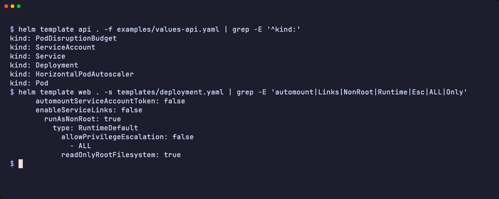
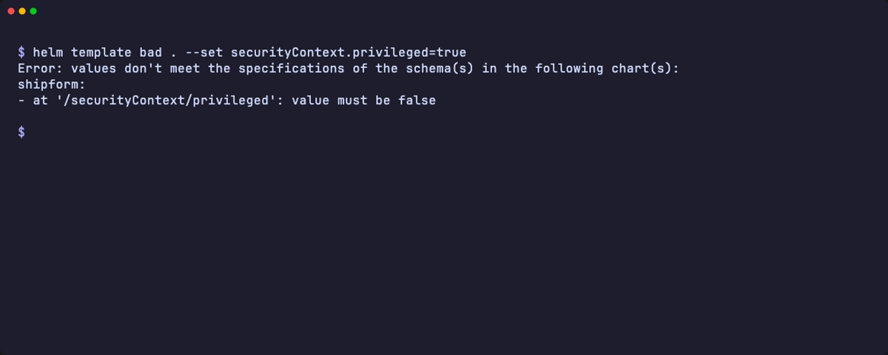

<p align="center">
  <picture>
    <source media="(prefers-color-scheme: dark)" srcset="docs/assets/logo-dark.svg">
    
  </picture>
</p>

<p align="center">
  <strong>One Helm chart for APIs, workers, StatefulSets, Jobs and CronJobs, secure by default.</strong><br>
  Configure everything through values; the schema rejects unknown keys and unsafe settings.
</p>

<p align="center">
  <a href="https://github.com/faridlamaul/shipform/actions/workflows/ci.yaml"></a>
  <a href="https://github.com/faridlamaul/shipform/actions/workflows/publish.yaml"></a>
  <a href="https://github.com/faridlamaul/shipform/releases/latest"></a>
  <a href="https://kubernetes.io"></a>
  <a href="https://helm.sh"></a>
  <a href="https://opensource.org/licenses/MIT"></a>
</p>

<p align="center">
  
</p>

shipform deploys one application workload per Helm release (a Deployment, StatefulSet, Job or CronJob) plus the Service, routing, scaling, secrets and monitoring resources it needs. It is for teams that want one reviewed chart instead of a copy per service.

- **Secure defaults:** non-root, read-only root filesystem, no added capabilities, no Service links, no ServiceAccount token. The default install passes the restricted Pod Security Standard.
- **Schema-checked values:** `values.schema.json` rejects unknown keys, wrong shapes, privileged containers and `hostPath` volumes at render time.
- **One chart for every component:** API, worker, internal service, StatefulSet, batch Job, CronJob, plus companion migration Jobs and cleanup CronJobs.
- **GitOps-friendly:** deterministic manifests, no random names, works with Argo CD and Flux.

<details>
<summary><strong>Contents</strong></summary>

- [How it works](#how-it-works)
- [Installation](#installation)
- [Quick start](#quick-start)
- [Security defaults](#security-defaults)
- [Workloads and hooks](#workloads-and-hooks)
- [Persistence](#persistence)
- [Routing](#routing)
- [Upgrading](#upgrading)
- [Troubleshooting](#troubleshooting)
- [Contributing](#contributing)
- [Ownership](#ownership)
- [License](#license)

</details>

## How it works

One release renders one main workload, chosen by `workload.type`; use one release per component. `values.schema.json` validates every value at render time.

Scope:

- No multi-Deployment releases, no CRDs, no ClusterRoles, and no environment-specific domains or vendor annotations.
- Not a database operator. Use a managed service or a database-specific operator for replication, backup and failover.

### Supported blocks

Each row is a top-level block in [`values.yaml`](values.yaml). `—` marks a block with no example file; its link names the key in `values.yaml`.

| Block | What it renders | Example |
|---|---|---|
| `workload.type: Deployment` | HTTP API | [values-api.yaml](examples/values-api.yaml) |
| `workload.type: Deployment`, no Service | Queue worker | [values-worker.yaml](examples/values-worker.yaml) |
| `workload.type: StatefulSet`, `statefulSet` | StatefulSet, headless Service, volume claim templates | [values-statefulset.yaml](examples/values-statefulset.yaml) |
| `workload.type: Job`, `job` | Job run as a `post-install,post-upgrade` hook | — ([`job`](values.yaml)) |
| `workload.type: CronJob`, `cronjob` | CronJob | [values-cronjob.yaml](examples/values-cronjob.yaml) |
| `jobs`, `cronJobs` | Companion Jobs (always Helm hooks, for example a migration) and CronJobs | [values-migration-job.yaml](examples/values-migration-job.yaml) |
| `service` | ClusterIP, NodePort, LoadBalancer or headless Service | [values-internal-service.yaml](examples/values-internal-service.yaml) |
| `ingress` | Ingress with TLS | [values-public-ingress.yaml](examples/values-public-ingress.yaml) |
| `httpRoute`, `grpcRoute` | Gateway API HTTPRoute and GRPCRoute | [values-gateway.yaml](examples/values-gateway.yaml) |
| `autoscaling` | HorizontalPodAutoscaler (Deployment only) | [values-api.yaml](examples/values-api.yaml) |
| `keda`, `verticalPodAutoscaler` | KEDA ScaledObject (scale to zero) and VerticalPodAutoscaler | [values-worker-keda.yaml](examples/values-worker-keda.yaml) |
| `podDisruptionBudget` | PodDisruptionBudget | [values-api.yaml](examples/values-api.yaml) |
| `persistence` | PersistentVolumeClaim `<fullname>-data` mounted in the main container | [values-persistence.yaml](examples/values-persistence.yaml) |
| `externalSecret` | ExternalSecret (`external-secrets.io/v1`) | [values-secure-production.yaml](examples/values-secure-production.yaml) |
| `configMap`, `secret` | ConfigMap `<fullname>-config`; Secret `<fullname>-secret` (development use) | — ([`configMap`](values.yaml)) |
| `tmpDir` | `emptyDir` mounted at `/tmp` | — ([`tmpDir`](values.yaml)) |
| `serviceAccount`, `rbac` | ServiceAccount, namespaced Role and RoleBinding | — ([`serviceAccount`](values.yaml)) |
| `networkPolicy` | NetworkPolicy with an optional DNS egress rule | [values-internal-service.yaml](examples/values-internal-service.yaml), [values-secure-production.yaml](examples/values-secure-production.yaml) |
| `serviceMonitor` | Prometheus Operator ServiceMonitor | [values-secure-production.yaml](examples/values-secure-production.yaml) |
| `podMonitor`, `prometheusRule` | Prometheus Operator PodMonitor (not with `serviceMonitor`) and PrometheusRule | — ([`podMonitor`](values.yaml)) |
| `extraObjects`, `tests` | Any extra manifest, rendered through `tpl`; `helm test` connection check | — ([`extraObjects`](values.yaml)) |


## Installation

Requirements:

- Kubernetes 1.25 or later (`kubeVersion: ">=1.25.0-0"` in `Chart.yaml`).
- Helm 3 or Helm 4. CI tests Helm v3.22.1 and v4.3.1.
- Optional operators, only for the blocks that use them: Gateway API CRDs (`httpRoute`, `grpcRoute`), External Secrets Operator (`externalSecret`), Prometheus Operator (`serviceMonitor`, `podMonitor`, `prometheusRule`), KEDA (`keda`) and the VPA CRDs (`verticalPodAutoscaler`).

From GHCR (OCI):

```bash
helm upgrade --install user-api oci://ghcr.io/faridlamaul/charts/shipform \
  --version 0.4.0 \
  --namespace applications --create-namespace \
  -f values-user-api.yaml
```

From the Helm repository:

```bash
helm repo add shipform https://faridlamaul.github.io/shipform
helm repo update shipform
helm upgrade --install user-api shipform/shipform \
  --version 0.4.0 \
  --namespace applications --create-namespace \
  -f values-user-api.yaml
```

With no values file, the chart deploys `nginxinc/nginx-unprivileged:1.27` on port 8080 as uid 101. Use it to check a cluster first.

To remove a release, run `helm uninstall user-api --namespace applications`. The `persistence` claim stays while `persistence.keep` is `true`. The main Job hook stays until `ttlSecondsAfterFinished` (default 300) removes it. The default `hookDeletePolicy` deletes companion Jobs when they succeed.

## Quick start

Save this as `values-user-api.yaml`: three replicas of an HTTP API on port 8080 behind a ClusterIP Service on port 80.

```yaml
nameOverride: user-api
replicaCount: 3

image:
  repository: ghcr.io/example/user-api
  tag: "1.4.2"

readinessProbe:
  enabled: true
  httpGet:
    path: /readyz
    port: http

livenessProbe:
  enabled: true
  httpGet:
    path: /healthz
    port: http
```

Render it first to run the schema checks locally:

```bash
helm template user-api oci://ghcr.io/faridlamaul/charts/shipform --version 0.4.0 -f values-user-api.yaml
```

The default `containerPorts` (`http`, 8080) and `service.ports` (`http`, 80 to `http`) already match this API. For fuller setups, start from a file in [`examples/`](examples/).


## Security defaults

The default install passes the restricted Pod Security Standard (CI checks this on kind). You can relax each default per release, except the schema guards.

<p align="center">
  
</p>

| Default | Values | How to relax |
|---|---|---|
| Run as non-root with the `RuntimeDefault` seccomp profile | `podSecurityContext.runAsNonRoot: true` | An image that starts as root fails with a non-root error. Set `podSecurityContext.runAsUser` to its unprivileged user, as [values-statefulset.yaml](examples/values-statefulset.yaml) does. `runAsNonRoot: false` fails the restricted standard. |
| No privilege escalation, all capabilities dropped | `securityContext.allowPrivilegeEscalation: false`, `securityContext.capabilities.drop: [ALL]` | Add `NET_BIND_SERVICE` under `securityContext.capabilities.add` to bind ports below 1024. No other capability is allowed. |
| Read-only root filesystem | `securityContext.readOnlyRootFilesystem: true` | A write outside `/tmp` logs `Read-only file system`. Mount a volume at each path the application writes to, or set `securityContext.readOnlyRootFilesystem: false`. |
| Writable `/tmp` | `tmpDir.enabled: true`, `sizeLimit: 64Mi` | Set `tmpDir.enabled: false` to remove it. Set `tmpDir.medium: Memory` for a tmpfs that counts against the memory limit. The chart skips its volume when `volumeMounts` already mounts `/tmp`. |
| No Service environment variables | `enableServiceLinks: false` | Set `enableServiceLinks: true`. Prefer DNS names. |
| No ServiceAccount token in the pod | `serviceAccount.automount: false` | Set `serviceAccount.automount: true` when the pod calls the Kubernetes API, for example with `rbac.rules`. It applies to the ServiceAccount and the pod. |
| DNS egress when a NetworkPolicy restricts Egress | `networkPolicy.allowDNS.enabled: true` | Allows port 53 (UDP and TCP) to CoreDNS in `kube-system`; renders only when `policyTypes` contains `Egress`. Set `allowDNS.enabled: false` to remove it, or change `allowDNS.to`. |

Guards with no opt-out. The schema rejects these values in the main container, init containers, extra containers and companions:

- `securityContext.privileged: true`.
- Any `hostPath` volume.
- Any entry in `securityContext.capabilities.add` other than `NET_BIND_SERVICE`.

<p align="center">
  
</p>

Also pin image tags, prefer `externalSecret` over `secret` for real credentials, and enable `networkPolicy` where the CNI enforces it.

## Workloads and hooks

`workload.type: Job` renders the Job as a `post-install,post-upgrade` Helm hook, because a Job's pod template is immutable. Every install and upgrade replaces the Job and runs it again, and Helm waits for it to finish, so raise `--timeout` for long jobs. Argo CD maps this hook to PostSync and runs it on every sync. Batch containers get no probes and no ports.

Companion `jobs` and `cronJobs` run next to the main workload. Each key names one resource, `<fullname>-<key>`, of at most 63 characters for a Job and 52 for a CronJob; a longer name fails the render.

- **Every companion Job is a hook.** An empty `hook` means `post-install,post-upgrade`. Companion CronJobs are normal resources.
- **Pre-install hooks run first.** A Job whose `hook` includes `pre-install` runs before the chart's ConfigMap, Secret, ExternalSecret and ServiceAccount exist. Helm creates those normal resources only after pre-install hooks finish. On the first install, read credentials from a Secret that already exists.
- **ServiceAccount.** An explicit `serviceAccountName` on the entry wins. A `pre-install` hook uses the namespace `default` ServiceAccount while `serviceAccount.create` is `true`, because the chart's ServiceAccount does not exist yet. Every other companion uses the release ServiceAccount. When `serviceAccount.create` is `false`, that is `serviceAccount.name`, or `default` when the name is empty.
- **Inheritance.** A companion takes the root image, `imagePullSecrets`, `env`, `envFrom`, `volumes`, `volumeMounts`, security contexts, scheduling fields and `tmpDir`. `command`, `args` and `resources` come only from its own entry. It skips each mount that has no volume in its pod, such as a StatefulSet claim template.
- **Selectors.** Companion pods carry `app.kubernetes.io/name: <name>-<key>`, so the main Service, PodDisruptionBudget and NetworkPolicy skip them.

## Persistence

`persistence.enabled: true` creates a PersistentVolumeClaim named `<fullname>-data` and mounts it at `persistence.mountPath` (default `/data`). It works for Deployment, Job and CronJob workloads; a StatefulSet uses `statefulSet.volumeClaimTemplates` instead.

- **Kept on uninstall.** While `persistence.keep` is `true` (the default), the claim carries `helm.sh/resource-policy: keep`. Delete it by hand when you no longer need the data.
- **ReadWriteOnce needs one pod at a time.** With more than one replica, or with the default `RollingUpdate` strategy, a new pod can stay pending while the old pod holds the volume. A pending pod after an upgrade is this case. Run one replica with `deploymentStrategy.type: Recreate`, as [values-persistence.yaml](examples/values-persistence.yaml) does, or use a `ReadWriteMany` storage class.
- **Existing claims.** Set `persistence.existingClaim` to mount a claim managed elsewhere; the chart then creates none.
- **Storage class.** `storageClassName: null` uses the cluster default; `""` requests no class.

## Routing

`ingress`, `httpRoute` and `grpcRoute` all point at the chart Service, so they need `service.enabled: true`.

Each Ingress path and each route rule names its backend with `servicePort`, either a `service.ports` name or number. When a route rule gives no `servicePort`, the backend falls back to the Service port named `http` for an HTTPRoute and `grpc` for a GRPCRoute. A `servicePort` that matches no `service.ports` entry fails the render with `servicePort "x" matches no service.ports entry`.

## Upgrading

Read [CHANGELOG.md](CHANGELOG.md) before every minor upgrade; 0.3.0 and 0.4.0 have upgrade notes.

0.4.0 renames the chart from `application-chart` to `shipform`. The chart name feeds resource names and the immutable `app.kubernetes.io/name` selector label. Before upgrading a 0.3.x release that does not set `nameOverride`, add:

```yaml
nameOverride: application-chart
```

Then run the [install command](#installation) against the new chart, or point your GitOps source at it.

0.4.0 also turns on the read-only root filesystem, the `/tmp` volume, `enableServiceLinks: false` and the schema guards. The guards have no opt-out; the CHANGELOG lists how to restore the other behaviors.

## Troubleshooting

| Symptom | Cause | Fix |
|---|---|---|
| `additional properties '…' not allowed`, or an error on `privileged`, `hostPath` or `capabilities.add` | Unknown key, or a guard with no opt-out | Fix the key, or remove the guarded setting. |
| `volumes: the name "tmp" is reserved …` | A user volume named `tmp` while the chart adds its own `/tmp` volume | Rename the volume, set `tmpDir.enabled: false`, or mount your own volume at `/tmp` as [values-secure-production.yaml](examples/values-secure-production.yaml) does. |
| `Read-only file system` or a non-root error | A secure default | See the relax column in [Security defaults](#security-defaults). |
| `autoscaling.enabled is supported only for workload.type Deployment` | HPA on another workload type | Use `keda` instead. |
| `helm test` times out | A NetworkPolicy blocks the test pod | Set `tests.enabled: false`, or allow pods labeled `app.kubernetes.io/component: test`. |

## Contributing

### Development

Run the checks that CI runs from the repository root.

```bash
make lint   # helm lint --strict on the defaults and every example, then renders values-api.yaml
make test   # helm-unittest suites in tests/ (needs Docker)
```

Install on a local [kind](https://kind.sigs.k8s.io) cluster, in a namespace that enforces the restricted Pod Security Standard like the CI `install` job:

```bash
kind create cluster --name shipform-dev
kubectl create namespace restricted
kubectl label namespace restricted pod-security.kubernetes.io/enforce=restricted
helm install web . -n restricted --wait --timeout 3m
helm test web -n restricted --logs
helm uninstall web -n restricted
```

CI (`.github/workflows/ci.yaml`) runs on every pull request. It lints and renders on both Helm versions and runs the unit tests. kubeconform validates against Kubernetes 1.25 and 1.33. A kind job installs the defaults, a StatefulSet and the Redis example. It also checks a Job upgrade, the migration hook and the persistence example.

To release:

1. Bump `version` in `Chart.yaml` and add a `CHANGELOG.md` entry.
2. Merge to `main`.
3. `.github/workflows/publish.yaml` runs CI. If no `shipform-<version>` tag exists yet, it packages the chart and pushes it to `oci://ghcr.io/faridlamaul/charts`. It then adds the chart to the `gh-pages` Helm repository and creates the `shipform-<version>` tag with a GitHub Release.

The tag is created last, so a failed publish can be re-run. A push that keeps `version` publishes nothing.

### Re-recording the demo

To re-record the demo and the two terminal screenshots after a change to the output, install [VHS](https://github.com/charmbracelet/vhs) and run `make demo`. The tape in [`docs/demo/demo.tape`](docs/demo/demo.tape) renders this chart with the local `helm`, so it needs no registry or cluster.

## Ownership

- **Maintainer:** [af/faridlamaul](https://github.com/faridlamaul)
- **Repository:** [faridlamaul/shipform](https://github.com/faridlamaul/shipform)
- **Issues:** [GitHub Issues](https://github.com/faridlamaul/shipform/issues)

## License

MIT License © 2026 Ahmad Lamaul Farid.
